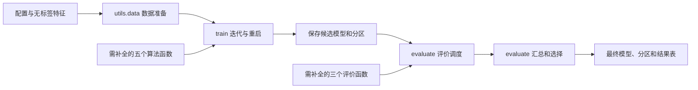

# 第二题框架：模块、接口和补全任务

框架负责串起实验流程，请在 `submission.py` 中补全五个算法函数和三个评价函数。其余模块已提供。

环境安装与常规运行见[代码运行说明](../../README.md#q2)，实验要求见[实验文档](../../lab2.pdf)。本文集中说明框架接口、配置、输出与调试方法。

## 1. 常规实验流程



`main.py` 按顺序连接这些步骤，`extras.py` 提供自检和分阶段运行等辅助操作。数据读取、搜索循环、抽样、重启调度和文件保存均已实现，无需补写。只要函数符合接口，同一套 PyTorch 实现就能用于 CPU、GPU、小例子自检和正式数据。

## 2. 每个模块做什么

```text
q2_clustering/
├── main.py           # 常规实验入口
├── submission.py     # 需补全的八个 TODO
├── train.py          # KMeans / GMM 迭代、重启与候选遍历
├── evaluate.py       # 指标调度、跨种子汇总与选择
├── extras.py         # 自检、回放、开发模式、核验与归档
├── utils/
│   ├── data.py       # 配置、特征与预处理
│   ├── runtime.py    # 设备、精度与检查容差
│   └── results.py    # 候选、模型与运行记录的保存
├── config.json
├── data/
└── tests/
```

`main.run()` 的顺序为读取配置、准备数据、`train.fit_candidates()` 拟合、`evaluate.evaluate_candidates()` 评价与选择，最后保存结果。`train.py` 中的 `fit_kmeans()` 和 `fit_gmm()` 只负责一次候选的迭代与重启；`submission.py` 提供需补全的算法和评价函数。

数据结构中，`features` 为原始特征，`fit_features` 为按配置预处理后的拟合特征，`evaluation_indices` 为公共评价子集。评价和拟合使用哪个空间在调用处明确区分。

## 3. 需要补全的接口

### 五个算法函数

```python
init_centers_kmeanspp(X, n_clusters, rng) -> centers
assign_clusters(X, centers) -> labels, min_sq_dist
update_centers(X, labels, old_centers) -> centers
gmm_estep(X, weights, means, variances) -> resp, mean_log_likelihood
gmm_mstep(X, resp, reg_covar) -> weights, means, variances
```

八个 TODO 均在 `submission.py` 中，签名保持原样，具体形状、边界行为与异常见各函数 docstring。算法使用框架指定设备上的 PyTorch Tensor，平均对数似然也可返回 Python float。浮点数据由配置 `dtype` 或命令行 `--dtype` 选择，默认 float32，也支持 float64；新张量应继承 `X.dtype` 和 `X.device`，例如 `X.new_zeros(...)`。算法返回的簇编号使用 `torch.int32` 或 `torch.int64`。

初始化函数的 `rng` 是框架已设置种子的同设备 `torch.Generator`，随机抽样时传入 `generator=rng`。不要修改输入张量。框架检查形状、设备、有限值、责任度归一化和参数合法性，容差随精度设置。

### 三个评价函数

```python
silhouette_score(X, labels) -> float
calinski_harabasz_score(X, labels) -> float
davies_bouldin_score(X, labels) -> float
```

三个接口只接收无标签特征和预测分区，评价标签为同设备的 `torch.int64` Tensor。簇编号允许不连续，计算依据实际非空簇数；返回有限的 Python float 或同设备零维 Tensor，不修改输入。三个函数都使用 PyTorch 计算，不写 NumPy 分支。

- **Silhouette**：框架先无放回抽取固定子集，所有候选共用；评价函数不再抽样。使用欧氏距离，单样本簇按 0 处理。允许子集的 N×N 距离矩阵，避免 N×N×D 临时数组。
- **CH**：使用全量原始 X，计算簇间/簇内离散度比值；越大越好。零簇内离散度采用与旧库一致的返回约定，见接口说明。
- **DB**：使用全量原始 X，计算簇内散度与中心间距的比值；越小越好。近零判断固定为 `atol=1e-8, rtol=0`，两种精度相同：所有簇内平均距离或所有中心间距离均不超过 `1e-8` 时返回 0；否则仅排除中心距离恰为 0 的簇对，正的中心距离仍参与计算。完整约定见接口说明。

三个指标都在原始特征空间计算，即使拟合时开启了标准化。请使用 PyTorch 补全公式；scikit-learn 等库只能用于独立核验，不能用现成聚类求解器、初始化器或评价函数替代 TODO。框架使用 NumPy 读写文件，补全函数不得把完整特征或标签转成 NumPy 计算。

多数票 ACC 由课程组使用隐藏标签计算，不能用隐藏标签选择结果。

## 4. 数据与配置

`data/features.npz` 只包含匿名特征矩阵 `X`，形状 `(56000, 512)`，类型为 `float32`。全部样本参与聚类，数据内容和行顺序须保持固定。发布文件的 SHA-256 保存在 [data/SHA256SUMS.txt](data/SHA256SUMS.txt)，可用于检查文件完整性。

实验参数集中在 `config.json`：

- `candidate_k`、`seeds`：两种方法共用的候选 K 与随机种子。至少两个不同的 K，均在 5 至 30 内；至少两个不同的非负整数种子。
- `n_init`：每个“方法、K、seed”组合的随机重启次数。
- `kmeans_max_iter` / `kmeans_tol`、`gmm_max_iter` / `gmm_tol`：迭代上限和停止阈值。
- `reg_covar`、`standardize`：GMM 方差正则化，以及是否按列标准化后拟合。
- `silhouette_sample_size`、`silhouette_seed`：固定评价子集的大小和抽样种子。
- `selection_metric`：主选择指标，默认 `silhouette`，也可设为 `calinski_harabasz` 或 `davies_bouldin`。
- `dtype`、`threads`：浮点精度和计算线程数，默认分别为 `float32`、`4`。

默认 K 为 `[5, 8, 10, 12, 15, 20, 25, 30]`，种子为 `[17, 42]`，共 32 个候选，每个候选做 3 次初始化；Silhouette 子集为 3,000 行。候选数量可按预算调整，仍须满足上述要求。

## 5. 运行与分阶段调试

以下命令均从 `q2_clustering/` 执行。每次使用新的输出目录，或已存在但为空的目录。

### 完整运行

补全算法和评价 TODO 后：

```bash
python extras.py self-check --device cpu
python main.py --device cpu
python extras.py check-output --output outputs_final
```

自检只使用小型例子，不读取正式数据。`main.py` 完成拟合、评价、选择与导出。使用 CUDA 时，将前两条命令中的 `--device cpu` 改为 `--device cuda`；CUDA 不可用时直接报错。设备也可通过 `LAB2_DEVICE` 设置，显式命令行参数优先。环境安装和 Slurm 配置见[代码运行说明](../../README.md#platform-107)。

### 分开拟合与评价

算法已补完、评价函数仍在调试时，先运行 `fit`：

```bash
python extras.py self-check --part algorithms --device cpu
python extras.py run --stage fit --device cpu \
  --config config.json --output outputs_fit
```

`fit` 只调用算法函数，评价 TODO 尚未补全也可运行；保存各候选但不选择最终模型。补完评价函数后：

```bash
python extras.py self-check --part metrics --device cpu
python extras.py evaluate --device cpu \
  --experiment outputs_fit --output outputs_evaluated
python extras.py check-output --output outputs_evaluated
```

`evaluate` 读取已保存的候选，只调用 `submission.py` 中的评价函数，不重新拟合。完成评价后，`outputs_evaluated/` 包含最终结果，无需再运行完整实验；只完成 `fit` 时尚无最终输出，不能用最终输出检查器核验。

### 调整评价设置

回放默认读取原实验的 `config.json`，只允许调整主指标、Silhouette 抽样大小或种子、线程数。另存配置并通过 `--config` 传入，例如将主指标改为 CH：

```bash
cp outputs_fit/config.json config_eval.json
# 将 config_eval.json 中的 selection_metric 改为 calinski_harabasz
python extras.py evaluate --device cpu \
  --experiment outputs_fit --config config_eval.json --output outputs_evaluated_ch
```

回放须沿用原数据、设备、精度和拟合参数。修改算法、候选 K、拟合种子或标准化等设置后，应重新拟合。

读取候选前，框架按 `plan.json` 核验原实验的 `config.json` 和 `fit_config.json`，并核对候选模型与标签的哈希。不要直接修改原输出目录中的文件。新结果保留原始拟合配置，不保存源码快照，实际运行代码须自行保留。

旧结果未记录 `dtype` 时按 float64 读取；旧版 `source_snapshot/fit_config.json` 仍可读取，其中的源码不会读取或复制到新输出。

## 6. 选择规则与输出

框架按“方法、K”汇总各个种子。所有计划种子拟合成功、主指标有效、实际非空簇数符合要求的组才参与选择，不能丢掉失败种子后只平均成功结果。

1. 按主指标的跨种子均值选组。Silhouette、CH 越大越好，DB 越小越好；差值在绝对 `1e-6` 内时，优先较小 K，再优先 KMeans。
2. 在选中组内按训练目标选代表运行：KMeans 取惯性最小的，GMM 取平均对数似然最大的；差值不超过 `1e-7 * max(1, abs(最优目标值))` 时，取较小 seed。

输出的主要结构：

```text
outputs_final/
├── config.json / fit_config.json  # 当前评价配置、原始拟合配置
├── plan.json                      # 输入与配置哈希、选择规则
├── input_summary.json             # 数据检查和尺度
├── preprocessing.npz              # 预处理参数
├── diagnostic_indices.npy         # 全部候选共享的评价子集
├── candidates/<run_key>/
│   ├── fit.json                   # 所有重启的轨迹；失败也保存
│   ├── model.npz                  # 成功候选的模型与预处理
│   └── clusters.npy               # 成功候选的原行序分区
├── runs.json / groups.json        # 逐次记录及跨种子统计
├── selection.json                 # 选择规则、选中运行或无有效组原因
├── export_manifest.json           # 导出候选身份与模型、标签校验值
├── results.json / manifest.json   # 汇总与实验完成状态
├── candidate_clusters.npz         # 全部成功候选的分区归档
└── model.npz / clusters.npy        # 有有效选择时导出的最终模型与分区
```

最终 `clusters.npy` 是形状 `(56000,)` 的一维非负整数数组，与原始输入逐行对应，实际非空簇数为 5 至 30。没有有效候选组时，不导出最终文件。

`runs.json` 记录拟合状态、训练目标、耗时和指标；`groups.json` 记录跨种子均值与样本标准差（`ddof=1`）。每个指标包含 `value/status/reason`，无定义时值为 `null`。拟合耗时与全流程耗时分别记录。

### 状态与文件检查

先查看 `manifest.json`。有最终结果或退出码为 0，仍可能有部分候选或指标失败。达到迭代上限的有限结果可以参与比较，是否充分收敛须结合候选的 `fit.json` 轨迹判断。

对已捕获的错误，单次重启失败后继续其他重启，候选全部重启失败后保存历史并继续其他候选。算法未实现时停止后续拟合；评价未实现或返回非法值时，记录状态并保留拟合产物。`RuntimeError` 等未捕获异常会终止实验，当前候选可能没有独立日志；根据终端报错和 `manifest.json` 排查，修正后用新输出目录重跑。

`extras.py check-output` 检查簇编号格式、文件哈希和导出来源，交叉核对配置、`results.json`、`selection.json`、`export_manifest.json`、`runs.json` 以及选中候选的 `fit.json`、模型与标签。该命令需要本地完整输出目录，不能单独核验提交的 `clusters.npy`。核验结果写入报告，第二题的运行产物仅需上传最终 `clusters.npy`；完整输出目录、实际运行代码和日志无需上传，请在本地保留至验收结束。检查器不重新预测标签或计算训练目标，不读取隐藏标签或计算教师 ACC；`passed: true` 表示文件检查通过，不证明算法正确或聚类效果好。

CLI 退出码：0 表示拟合全部成功，或评价阶段取得有效最终结果；1 表示未实现或失败导致请求结果不足；2 表示配置或输入等错误；拟合中断返回 130。退出码须结合 `manifest.json` 判断。

## 7. 辅助功能

本节命令也从 `q2_clustering/` 执行，先补全算法和评价 TODO。

### 小数据开发模式

生成小型特征文件和匹配配置：

```bash
python - <<'PYCODE'
import json
import numpy as np
rng = np.random.default_rng(17)
X = np.concatenate([rng.normal(-3, 0.3, (60, 2)),
                    rng.normal(3, 0.3, (60, 2))]).astype(np.float32)
np.savez("toy_features.npz", X=X)
with open("config.json") as f:
    cfg = json.load(f)
cfg.update(candidate_k=[2, 3], seeds=[17, 42], n_init=1,
           kmeans_max_iter=30, gmm_max_iter=30, silhouette_sample_size=120)
with open("config_dev.json", "w") as f:
    json.dump(cfg, f, indent=2)
PYCODE
python extras.py run --device cpu --development \
  --input toy_features.npz --config config_dev.json --output outputs_dev
python extras.py check-output --development --input toy_features.npz --output outputs_dev
```

该模式放宽数据大小与实际簇数限制，只用于调试，不能作为正式实验提交。检查时传入相同的 `--input` 和 `--development`。

### 切换精度

常规运行可在配置中设置 `dtype`；辅助入口也可通过 `--dtype float64` 切换双精度，自检使用相同精度：

```bash
python extras.py self-check --device cpu --dtype float64
python extras.py run --device cpu --dtype float64 \
  --config config.json --output outputs_float64
```

### 替换实现文件

自行准备同接口的实现文件后，通过参数指定：

```bash
python extras.py self-check --device cpu --implementation my_submission.py
python extras.py run --device cpu --config config.json \
  --implementation my_submission.py --output outputs_custom
```

默认使用 `submission.py`。`extras.py` 的 `self-check`、`run`、`evaluate` 均通过同一个 `--implementation` 参数指定实现文件。其他文件仅用于调试；正式运行前须将最终使用的完整实现同步回 `submission.py`，再用默认实现重新运行并核验最终输出。提交的 `submission.py` 必须与生成最终 `clusters.npy` 的实现一致。

### 读取候选标签归档

`main.py`、`extras.py run` 和 `extras.py evaluate` 自动生成 `candidate_clusters.npz`，汇总成功候选的标签；各候选目录仍保留 `clusters.npy`。查看归档中的候选名和数组形状：

```bash
python - <<'PYCODE'
import numpy as np
with np.load("outputs_final/candidate_clusters.npz", allow_pickle=False) as archive:
    for name in archive.files:
        print(name, archive[name].shape)
PYCODE
```

完整参数见 `python main.py --help`、`python extras.py --help` 及各子命令的 `--help`。
